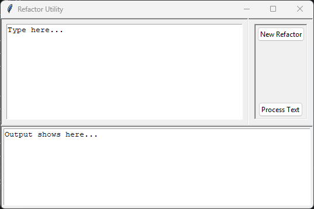

# Refactor Utility
**Project Type:** Coding Practice

**Status:** Ongoing

**Date:** September 2026


## Table of Contents
- [Overview](#overview)
- [How It Works](#how-it-works)
- [Assets](#assets)
  - [Demonstration](#demonstration)
  - [Source Code](#source-code)
- [Key Takeaways](#key-takeaways)


  
## Overview
  Refactor Utility is a Python-based desktop application developed using Tkinter. It allows users to identify specific words within a body of text and replace or redact them according to user-defined rules. The application provides a graphical interface for entering text, specifying multiple replacement rules, and displaying the processed result.


  
## How It Works
The graphical interface consists of three main sections: the input area, the refactor panel and the output area. These sections are organized using nested frames, with buttons provided to add new rules and initiate text processing.

### (1) Replacement Rule Configuration

Each replacement rule is managed through an instance of the Redactor class. When the New Refactor button is clicked, the program creates a new pair of entry fields: one for the target word and another for its replacement. This allows users to configure multiple replacement rules simultaneously.

The replacement field contains an asterisk "*" by default. If this value is retained, left blank, or set to "none", the program automatically generates a sequence of asterisks equal in length to the target word. Alternatively, you can input a desired word or phrase replacement.

All active replacement rules are collected into a Python dictionary, where target words serve as keys and their corresponding replacements serve as values.

### (2) Text Processing

When the Process Text button is clicked, the iterate_response() function retrieves the configured replacement rules and the text entered by the user.

The input text is divided into individual elements using spaces as separators. Each element is then checked against the replacement dictionary after removing selected punctuation marks from its beginning and end.

If a match is found, the original element is replaced with its corresponding dictionary value. Otherwise, it is retained unchanged. The processed elements are progressively assembled into a new string.

For example, given the sentence:

Daniel visited Meridian Robotics to meet Sarah and Simon.

With the replacement rules:

Daniel → ******

Sarah → Selma

Meridian → Forefront

The program produces:

****** visited Forefront Robotics to meet Selma and Simon.

Some known issues: In the current implementation, punctuation marks attached to matched words are removed during replacement. Only a few punctuation marks are identifiable too.

### (3) Output Display

After processing the program inserts the newly generated text.

The original input remains unchanged, allowing users to modify their replacement rules and process the same document again without re-entering it.

## Assets


### Demonstration


[Video](<engineered-by-tenoch/refactor-tool/Assets/Demo.mp4>)

### Source Code
[Script](<Assets/Code/Refactor.py>)
```python
from tkinter import *
from tkinter import ttk

root = Tk()
root.title("Refactor Utility")

entry_frame = ttk.Frame(root)
entry_frame.pack(fill="both", expand=True)
entry_frame.config(relief="sunken")

action_frame = ttk.Frame(entry_frame)
action_frame.pack(side="right", anchor="nw", padx=10, pady=10, fill="y")
action_frame.config(relief="sunken")

input_frame = ttk.Frame(entry_frame)
input_frame.pack(side="left", anchor="ne", fill="both", expand=True)
input_frame.config(relief="sunken")

output_frame = ttk.Frame(root)
output_frame.pack(fill="x", side="bottom")
output_frame.config(relief="sunken")

entry = Text(input_frame, height=10, width=50)
entry.insert(1.0, "Type here...")
entry.pack(side="left", padx=10, pady=10, fill="both", expand=True)
entry.config(wrap='word')


output = Text(output_frame, height=8, width=50)
output.pack(side="left", padx=5, pady=5, expand=True, fill="both")
output.insert(1.0, "Output shows here...")
output.config(wrap='word')


redox_dict = {}
n_refactors = 1
refactorers = []
all_redactors = []


class Redactor:
    def __init__(self, rid):
        global refactorers
        self.rid = rid
        self.a = None
        self.b = None
        refactorers.append(self.rid)

    def generate(self):
        row_frame = ttk.Frame(action_frame)
        row_frame.pack(side="top", fill="x", padx= 2, pady=0)

        self.a = ttk.Entry(row_frame, width=8)
        self.a.pack(side="left", padx=2.5, pady=2.5)

        self.b = ttk.Entry(row_frame, width=4)
        self.b.pack(side="right", padx=2.5, pady=2.5)
        self.b.insert(0, "*")

    def redact_process(self):
        redox = self.a.get()
        refactor = self.b.get()

        if not redox:
            return

        if refactor in ("none", "","*"):
            refactor = len(redox) * "*"

        redox_dict[redox] = refactor


def generate_substitute():
    global n_refactors
    new_row = Redactor(rid=n_refactors)
    new_row.generate()
    all_redactors.append(new_row)
    n_refactors += 1


def iterate_response():
    redox_dict.clear()

    for redactor in all_redactors:
        redactor.redact_process()

    document = entry.get(1.0, END).strip()
    words = document.split(" ")


    result = ""
    for word in words:
        clean_word = word.strip(".,!?")

        if clean_word in redox_dict:
            result += redox_dict[clean_word] + " "
        else:
            result += word + " "


    output.delete(1.0, END)
    output.insert(1.0, result.strip())


add_redaction = ttk.Button(action_frame, text="New Refactor", command=generate_substitute)
add_redaction.pack(side="top", padx=5, pady=5)

process_btn = ttk.Button(action_frame, text="Process Text", command=iterate_response)
process_btn.pack(side="bottom", padx=5, pady=5)

root.mainloop() -the refactor utility. i need to document it, what should i put in what sections, somewhatt consistency in format from existing project doc formats

```

## Key Takeaways

- Event-driven programming allows a program's operations to be controlled by user actions rather than a predetermined sequence, making it particularly useful for developing interactive applications.

- Dictionaries are an efficient way to associate and retrieve values, making them particularly useful for implementing the user-defined replacement rules in this system.

- A well-designed interface should accommodate different user requirements without introducing unnecessary complexity. 

- Tkinter provides a means of developing standalone graphical applications in Python, with widgets, layout managers and event handlers supporting the organization and functionality of the interface.


